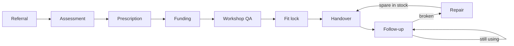
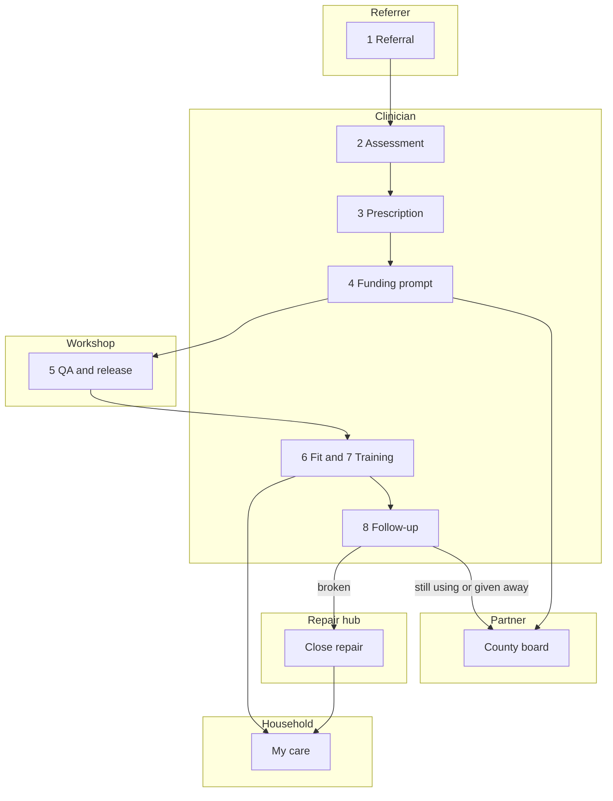

# System flow

How a device moves through AfriAssistive, and where each action lives. This matches the pilot. Channels drawn as USSD or WhatsApp do not leave the browser.

## The chain

The service has eight steps. The software does not skip one because a later screen is more convenient.

1. **Referral.** Someone asks for a device.
2. **Assessment.** A clinician sees the person.
3. **Prescription.** The device and the size are signed.
4. **Funding.** A listed tariff, a grant for the gap, or a household plan. The gap is not hidden inside the tariff.
5. **Preparation.** The workshop builds the device and passes QA.
6. **Fitting.** Six checks, all required, then handover.
7. **Training.** One of the six fit checks is that the user was trained in their language.
8. **Follow-up.** At 2 weeks, 6 months, and 12 months. The result is still using, broken, or given away.

## Which role owns each step

The chain above is the service. This is who is allowed to move it, and which screen they use. A later role cannot tick an earlier box.

| Step | Who moves it | Screen | What stops the next step |
|---|---|---|---|
| 1. Referral | Community referrer, or the public request form | `/request`, then the referrer board and `/app/queue` | Nothing is signed yet. The referrer can only see status. |
| 2. Assessment | Clinician | `/app/queue` | The assessment is unsigned. |
| 3. Prescription | Clinician | `/app/queue` | The device and size are unsigned. Signing creates the work order. |
| 4. Funding | Clinician sends the prompt. Partner reads the gap. | Clinic day, `/app/claims`, county board | A listed tariff is not cash. The gap is not an SHA claim. A device with no tariff cannot be packed as one. |
| 5. Preparation | Workshop | Workshop radio and `/app/workshop` | Release stays off until every QA check is ticked. The repair hub does not see this list. |
| 6. Fitting | Clinician | Clinic day and `/app/devices` | Handover stays off until all six fit checks are ticked. |
| 7. Training | Clinician, with the person | The same fit lock. One of the six checks is training in the person's language. | An unticked training line blocks handover. |
| 8. Follow-up | Clinician records it. The household sees the next date. | Clinic day and My care | Due at 2 weeks, 6 months, and 12 months. The answer is still using, broken, or given away. |

Repair sits on step 8, not on a ninth step. Broken opens a ticket. The workshop or the repair hub closes it, and only when the spare is in stock. The household can see the ticket. They cannot close it.

## Who sees which board

The home page at `/app` is not one dashboard. Open the platform, then choose a role. The name of that role stays in the top bar. The switcher is a demo. It is not a staff login.

Seven roles, four jobs. Two of the jobs are split so the wrong person cannot finish them.

**Beneficiary.** The person, or the household, who has the device. My care shows that device, whether it is with them or in the workshop, the next check, and a sample receipt if the clinic has sent a prompt. They can report a fault. They can see an open repair. They cannot close it, sign a fit, or see anyone else's clinical notes. The household switcher on My care moves between sample homes on this phone. A real login would be one household.

**Community referrer.** The person in the community who sends someone to the service. Their board lists each referral and how far it has got. The queue is the same list, and it is read-only for them. They cannot assign a clinician, sign an assessment, sign a prescription, hand a device over, or send a payment prompt. Those stay with the clinic.

**Clinician.** The rehab worker who can stop a bad handover. Clinic day shows who is waiting, which device cannot be handed over, which care-plan prompt has not been sent, and which check is overdue. They sign the six-point fit lock. They sign the assessment and the prescription from the queue. They can prepare a claim pack. They do not release a device from the workshop.

**Workshop.** The technician who builds. Their radio shows spares that are low, jobs that have not passed QA, and open repairs. Release stays locked until every QA check is ticked. The longer checklist is also on the workshop page. Fitting the device to the person is not their job.

**Repair hub.** The bench that keeps a device working after it has left. They see the same radio, without the QA list. They order a spare, receive it, and close a repair once the part is on the shelf. The screen tells them a new device is released by the workshop, not by the hub.

**Partner / payer.** The county, donor, or insurer who paid. The county board shows devices still in use, overdue 12-month checks, the unfunded gap in shillings, and spare orders that have not arrived. A count small enough to name one household is hidden. The device list shows serial, model, and county. It does not show the owner's name. They can open a claim pack. They cannot sign a fit.

**Ops / DPO.** The same county board, plus a short audit of who released a device, who signed a fit, and who prepared or blocked a claim. They can open every room, because someone has to see the whole trail. That audit is a sample. It is not an ODPC record.

| Role | Home | What they must not do |
|---|---|---|
| Beneficiary | My care | Close a repair, sign a fit, send a payment |
| Referrer | Referral list | Sign an assessment, a prescription, or a fit |
| Clinician | Clinic day | Release a device from QA |
| Workshop | Workshop radio, with QA | Hand the device to the person |
| Repair hub | Workshop radio, without QA | Release a new device |
| Partner / payer | County board | See owner names on the device list, or sign a fit |
| Ops / DPO | County board and the audit | Treat the audit as a statutory record |

## Flow A — from request to a device in the house

1. A referrer opens **Request a device** (`/request`) or the **queue** (`/app/queue`). The person is a sample record.
2. The clinician prescribes. The referral moves forward only when that step is signed.
3. The **workshop** role, on the workshop radio, lists jobs that are still building or still in QA. The repair hub does not see this list. **Release** stays off until every QA check is ticked: frame, wheels, brakes, seat, footrest, load test, serial and QR, manual in the chosen language. The same checks exist on `/app/workshop`.
4. Release mints a serial and a QR token in that click. The device is in stock, linked to the person, and the fit lock is still open. The county story does not treat this as a completed issue.
5. **Clinic day** shows the person under **Cannot hand over**. The six fit checks are seat, footrest, brakes, pressure, training in their language, and a named caregiver or independence. **Hand over** stays off until all six are ticked. The same lock is on `/app/devices`.
6. Handover marks the device delivered, stamps who signed the fit, and writes three follow-ups: 2 weeks, 6 months, 12 months.
7. **My care** then says the device is with that household. The household switcher moves between sample homes. It is not a login.

## Flow B — something breaks

1. The person reports a fault on `/fault`, or from the passport, or the clinic marks a follow-up **Broken**.
2. A ticket opens. If a matching device is on the shelf with no owner, it goes out as a loaner.
3. The **workshop** or the **repair hub** sees the open repair on the radio. If the failed spare is at zero, **Close repair** stays off. **Order** creates a spare order. **Receive** puts the quantity back on the shelf. The county board lists spare orders that are still open. The household can see the ticket. They cannot close it.
4. Closing the repair returns the device to the household and sends the loaner home to the shelf.
5. **My care** moves from “in the workshop” back to “with you.”

## Flow C — money, without pretending it moved

1. A care plan can be offered. Joyce’s sample plan is the basic tier at KES 300.
2. **Clinic day** lists offered plans. **Send prompt** writes a sample receipt: paybill `880155`, the device serial as the account, twelve months, and the next date. The screen says it is not a live debit.
3. **My care** shows that receipt. A plan that was already active, with no receipt stored, says so. It does not invent one.
4. **Claims** (`/app/claims`) prepares a pack per device.
   - No fit, or not yet handed over: blocked.
   - No listed tariff: blocked. The whole cost is the gap.
   - Otherwise the pack is ready to copy, and the gap is cost minus the listed tariff.
5. Nothing is sent to SHA. Copying the pack is the end of this flow.

Tariffs used in the pilot:

| Device | Cost | Listed tariff | Gap |
|---|---:|---:|---:|
| Community wheelchair | 22,000 | 15,000 | 7,000 |
| Walking frame | 2,200 | 500 | 1,700 |
| Elbow crutches, pair | 1,300 | 900 | 400 |
| Paediatric AFO | 7,500 | none | 7,500 |
| ADL grip set | 300 | none | 300 |

A listed tariff still depends on that budget having been released. The pilot does not treat the tariff as cash received.

## Flow D — the county reads the result

**County board** is for a partner or an admin.

- Devices the follow-up says are still in use.
- Checks that are overdue, especially the 12-month one.
- The unfunded gap, in shillings, separate from anything a claim could carry.
- Spare orders that have not been received.

A count below five is withheld. A single household must not be readable from a total.

**Impact** (`/app/impact`) is the longer view of the same idea: outcomes, not a tally of devices that once left the workshop.

## The passport

- Token minted at release. Example shape: `9fK3x142`.
- Opening `/d/{token}` draws the QR in the browser. On a measured load the encoder took about 30 ms and the square about 2 ms. Nothing is uploaded to draw it.
- The square is the address of that page. The page shows model, serial, status, and warranty.
- The owner’s name is not on it.
- The registry that answers the token is stored in this browser (`afriassistive-pilot-v2`). Another phone gets “passport not found” until records live on a server.

## What is stored, and what is not

The pilot persists in `localStorage` on the machine that used it. Reset clears it back to the synthetic set. There is no staff account, no shared clinic database, and no production store of health data. That is deliberate. Real names wait on a registered company, an ODPC registration, and a data-protection assessment.

An audit line is written for the steps the pilot already cares about: QA release, fit lock, a prepared or blocked claim. It is a sample trail, not a statutory record.
